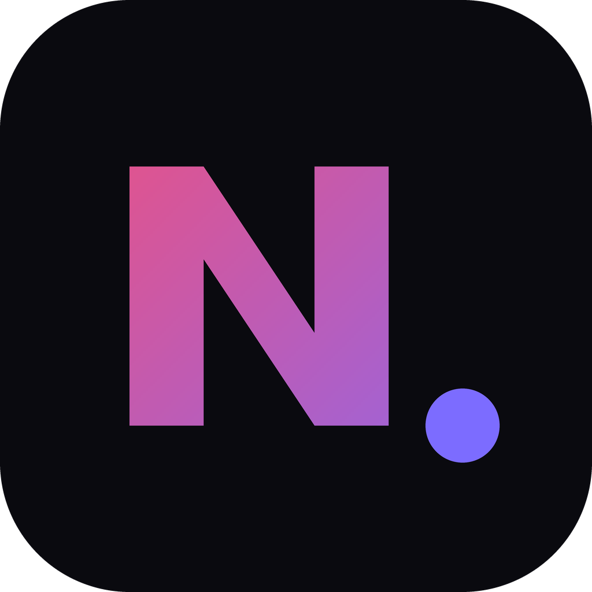

# NXShot 1.3.0

Nintendo Switch(CFW / Atmosphère)で動く常駐プログラム(sysmodule)です。
**Switch単体で**、ゲームの開始・終了と、撮ったスクリーンショットや動画をDiscordのWebhookへ送ります。PCは要りません。

*English: A tiny Atmosphère sysmodule that posts game start/stop notifications and new screenshots/videos straight to a Discord webhook. No PC needed. See the Japanese text below for install steps; the layout is the same as the SD card tree shown there.*

この配布には、2つが入っています。
- **常駐版**(`exefs.nsp`、版 1.3.0): Switchの裏で動いて、自動で送ります。
- **アプリ版**(`NXShot.nro`、版 1.3.0): ホームブリューメニューから起動して、昔の写真・動画を送ったり、設定(自動送信のオン/オフなど)を変えたりします。

## できること
- ゲームの開始 / 終了(プレイ時間つき)の通知
- スクリーンショットと動画(mp4)の自動投稿(**起動後に撮ったもの**だけ。起動時にすでにあったものは送りません)
- 大きすぎる動画は、**最初のほうを自動で削って**上限以内に収めて送ります(画質は落ちません。下の「動画について」)
- 起動すると「🟢 NXShot 起動」が届きます(Albumを読めたか、自動送信がオンかオフかも書いてあります)
- **自動送信のオン/オフ**: アプリの設定で切り替えられます(オフの間は、写真・動画を自動では送りません。ゲームの開始・終了の通知は続きます)
- **アプリ版**: Albumの昔の写真・動画を、**年・月でまとめて**表示します。写真はサムネ付き、動画は最初のコマのサムネと、再生プレビュー付きで選んで送れます。Switchの画面で設定も変えられます。

## 必要なもの
- Atmosphère が入ったSwitch
- Discordのサーバーで作ったWebhook URL(サーバー設定 → 連携サービス → ウェブフック)
- Wi-Fi(スクショの保存先はSDカード)

## インストール
1. [Releases](../../releases) から `NXShot-1.3.0.zip` をダウンロードして展開します。
2. 中の `atmosphere`、`config`、`switch` の3つのフォルダを、SDカードの直下にコピーします。
3. SDカードの `config/nxdiscord/config.txt` を開き、1行目の `[ここにWebhook URLを貼る]` を、自分のWebhook URLに書き換えて保存します(カッコも消して、URLだけにします)。2行目の `limit=10` はそのままで大丈夫です(下の「動画について」)。
4. Switchを再起動します。起動してしばらくすると、Discordに「🟢 NXShot 起動」が届きます。

SDカードの中身はこうなります。

    atmosphere/contents/4200000000000A7E/exefs.nsp
    atmosphere/contents/4200000000000A7E/flags/boot2.flag   (空ファイル)
    switch/NXShot/NXShot.nro                                (アプリ版。ホームブリューメニューに出ます)
    config/nxdiscord/config.txt
        1行目: DiscordのWebhook URL
        2行目以降(省略可):
            limit=10          送信できるファイルの上限(MB)
            trim=1            上限を超える動画の最初を削って送る(0で、削らず「送れなかった」と通知だけ)
            auto=1            写真・動画の自動送信(0でオフ)
            updcheck=1        アプリを開いたときに、新しい版を確かめる(0でしない)
            album=sdmc:/...   Albumの場所。通常は書かない

**すでに自分の `config.txt` がある人へ**: 上書きしないでください。`config` フォルダはコピーせず、`atmosphere` と `switch` だけを入れ替えれば、設定はそのまま使えます。
**旧版(NXDiscord.nro)から更新する人へ**: アプリの名前とフォルダが変わりました。古い `switch/NXDiscord` フォルダは削除してください(設定や送信済みの記録は、そのまま引き継がれます)。

## アプリ版(NXShot.nro)の使い方
ホームブリューメニュー(アルバムを、ボタンを押しながら開く、など。Atmosphereの標準のやり方)から「NXShot」を起動します。常駐版とは別のアプリで、**起動している間は、ゲームを遊べません**。

- **写真・動画を選んで送る**: **年 → 月** の順に選ぶと、その月の写真・動画が、サムネ付きの格子で出ます(「この年ぜんぶ」を選ぶと、1年分がまとめて出ます。日ごとには分けません)。
  - 十字キー(左スティックも可)で動かし、`A` でチェック、`Y` で全部チェック、`X` で送ります(何もチェックしていなければ、いま選んでいる1件を送ります)。`L` / `R` で1ページずつ飛べます。
  - 写真は縮小したサムネ、動画は最初のコマのサムネに「動画」の印が付きます。`ZR` で、写真は大きく、**動画は再生して**見られます(音は出ません。最後までいくと、くり返します)。
  - 大きい動画は、常駐版と同じく、最初を削って上限に収めます。上限を超えるものは、容量の文字の色で分かります(黄: 削って送る / 赤: 送れません)。
  - 送った記録は、`config/nxdiscord/app_sent.txt` に残り、「送信済」と出ます(同じものを、もう一度送ることもできます)。
- **設定**: Webhook URL、**写真・動画の自動送信(オン/オフ)**、上限(MB)、大きい動画を削るか、Albumの場所を、変えられます。変えた内容は、すぐ `config.txt` に保存されます(常駐版は、5秒ごとに読み直します)。長いURLをSwitchのキーボードで打つのは大変なので、PCで `config.txt` を書き換えるほうが楽です。
  - 自動送信をオフにすると、常駐版は写真・動画を送りません。オフの間に撮ったものは、あとでオンにしても、さかのぼっては送りません(必要なら、このアプリから選んで送れます)。
- **テスト送信**: Webhookが正しいかを確かめます。
- **アップデート**: GitHubのReleasesで新しい版を確かめ、あれば**アプリ(`NXShot.nro`)と常駐版(`exefs.nsp`)を、Switchの中だけで更新**します(要Wi-Fi)。アプリは更新後に自動で開き直します。常駐版は、Switchを再起動すると新しい版で動きます。設定で、起動時の自動チェックをオフにもできます。
- **写真の編集**(写真を大きく見る画面で **X**): 切り抜き、文字入れ(大きさ・色・フォント・ふちどり・太字/斜体)、ぼかし、モザイク、モーションブラー。編集したものは、そのままDiscordへ送れます(元の写真は変わりません)。「保存して続ける」で、`config/nxdiscord/edit/` にも残せます。
  - フォントは標準のほかに、`config/nxdiscord/fonts/` に `.ttf` `.otf` `.ttc` を入れると選べます(日本語を出したいときは、日本語の入ったフォントを)。
- **動画の切り取り**(動画を見る画面で **X**): 最初と最後を選んで、その間だけを切り出して送れます(再エンコードしないので速く、画質も変わりません)。開始は、キーフレームに合わせて少し早くなることがあります。
- **常駐版の状態とログ**: 常駐版が動いているか、版、`log.txt` の最後のほうを見られます。
- 終了は、メニューで `+` か、「終了」です。送信中に `B` で、いま送っているファイルを止められます。

うまく動かないときは、`config/nxdiscord/app_log.txt` を見てください(アプリの起動のたびに作り直されます)。サムネが出ないときは、このログに理由が残ります。

## 動画について
- Switchで撮った動画(最長30秒)も、スクリーンショットと同じように自動で送ります。
- Discordには、アップロードできるファイルの大きさに**上限**があります(ブーストなしのサーバーでは約20MB。Discord側の都合で変わることがあります)。Switchの動画はこれを超えることがあります。
- 動画が上限(`limit=`)を超えるときは、**最初のほうを削って**上限以内に収めてから送ります。
  - 動画を作り直さず、前の部分を切り捨てるだけなので、画質も音も元のままです。
  - 切れるのはキーフレームの位置(約0.25秒ごと)なので、削る長さは少し大きめになることがあります。
  - 送った動画のメッセージに、「最初の◯秒を削って送りました」と書きます。元の動画は変わりません。
  - 削っても収まらない(残りが2秒未満になる)場合や、削りたくない場合(`trim=0`)は、「送れなかった」とだけ通知します。
- `limit=` 以下でも、Discordのサーバーに断られた場合(http 413など)は、「送信失敗」と通知します。この場合は `limit=` を、実際に送れた大きさまで下げてください。
- ブーストしているサーバーなら、`config.txt` の `limit=` を大きくすると、大きい動画も送れます(例: `limit=50`)。サーバーの上限より大きくすると、送信に失敗します。
- 動画は送るのに時間がかかります。その間は、ゲームの開始・終了の通知が少し遅れることがあります。

## 開発者向け
動画を削る処理は `sysmodule/source/mp4trim.h` に、標準ライブラリだけで書いてあります。PCでも試せます。

    g++ -std=c++17 -O2 -o mp4trim_test tests/mp4trim_test.cpp
    ./mp4trim_test 入力.mp4 出力.mp4 上限バイト

## アンインストール
`atmosphere/contents/4200000000000A7E` フォルダ、`config/nxdiscord` フォルダ、`switch/NXShot` フォルダ(旧版なら `switch/NXDiscord`)を削除してください。

## うまく動かないとき
`config/nxdiscord/log.txt` を見てください。起動のたびに作り直されます(各行の先頭は起動からの秒数)。

| ログの内容 | 意味 |
|---|---|
| `main: start v1.3.0` が無い | 常駐が起動していません。`exefs.nsp` と `boot2.flag` の場所を確認し、Switchを完全に再起動 |
| `network: 未接続` のまま | Wi-Fiにつながっていません |
| `curl: global_init=0` 以外 | 通信ライブラリの初期化失敗 |
| `postJson` / `postShot` の `http 200〜204` | 送信成功 |
| `http 401` / `404` | Webhook URLが間違っている、または削除された |
| `http 413` | ファイルが大きすぎる(`limit=` がサーバーの上限より大きい) |
| `media: 上限超え` | `limit=` を超えるため送りませんでした |
| `trim: result=0` | 動画を削って収めました(`-2`: 未対応の形式、`-3`: 削っても収まらない) |

Webhook URLは `log.txt` には書き込まれません。

## 注意
- **セキュリティ**: SwitchにCA証明書の束が無いため、サーバー証明書の検証は行いません。通信経路を偽装される環境(信用できない公衆Wi-Fiなど)では使わないでください。
- `config.txt` にはWebhook URLが入ります。URLを知っている人は誰でもそのチャンネルに投稿できます。SDカードを人に渡すときや、スクショ・ログを公開するときは注意してください。
- CFW(カスタムファームウェア)上でオンライン機能を使うと、BANされるリスクがあります。自己責任で使ってください。このソフトはNintendoの公式サービスには接続せず、Discordにだけ通信します。
- 本ソフトはNintendoおよびDiscordとは無関係の非公式ツールです。
- 画像はDiscordへ送られます。写り込んだ個人情報や、送る相手には気をつけてください。

## ビルド
devkitPro(`devkita64`)に libnx と switch-curl が入った環境で次を実行します。

    make -C sysmodule      # 常駐版
    make -C app            # アプリ版(要 switch-sdl2 switch-sdl2_ttf switch-sdl2_image。動画のサムネ・プレビューには switch-ffmpeg も)

`sysmodule/out/nxdiscord.nsp` ができるので、`exefs.nsp` という名前でSDカードに置きます。アプリ版は `app/out/NXShot.nro` ができるので、`switch/NXShot/` に置きます。`switch-ffmpeg` が入っていないと、動画のサムネとプレビューが無い版になります(ほかは同じです)。アイコンは `app/icon.jpg`(256x256)です。
GitHub Actions(`.github/workflows/build.yml`)でもビルドできます。Releaseを公開すると、配布用zipが自動で添付されます。

## ライセンス
MIT License(`LICENSE` を参照)。
